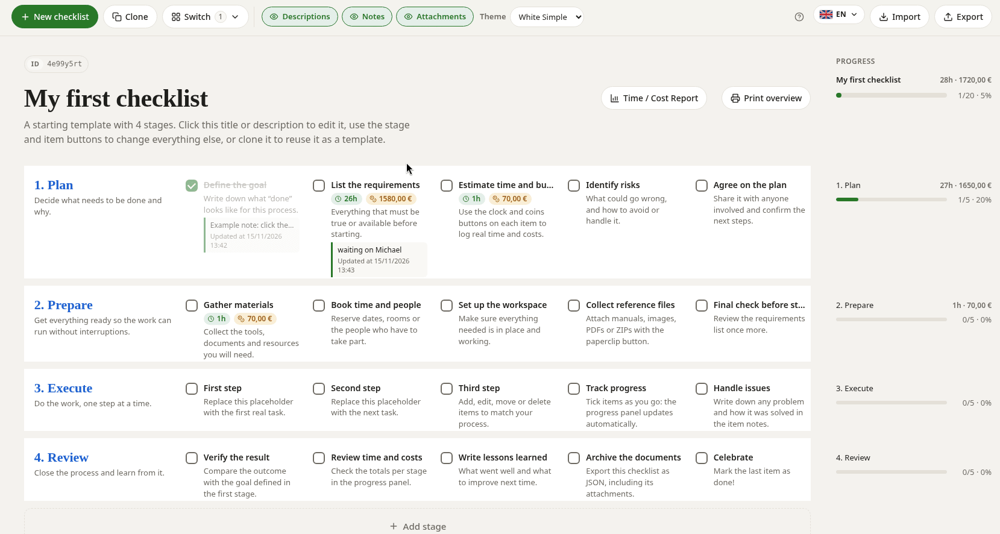

# checklist4life

Ultimate tiny portable single-file .html app to manage staged checklists with notes, attachments, time log tracking & cost tracking. It doesn't require any installation or server as everything is stored in your browser or in exported files.
Useful to work in systematic processes to not miss any step while managing the data, time, cost and progress in a single place.

Supported languages:
```
🇬🇧 English, 🇪🇸 Español, 🇩🇪 Deutsch, 🇫🇷 Français, 🇳🇱 Nederlands, 🇨🇳 中文, 🇷🇺 Русский
```



✨ All Features:

* Create separate checklist documents, made of stages and checklists
* Be able to switch between checklist documents
* **Automatic autosave** in browser database
* Each item has a **title, description and a checkbox** to track pending/done
* You can define **dynamic stages** and items
* Choose **1 to 7 columns** per stage and **reorder** stages and items
* You can **clone** a checklist document (which works as a template)
* You can **attach files**: pdfs, images, zip files to each item
* **Drag & drop** files onto an item to attach them
* You can **add a note** to a check item
* You can **log time and costs** per item
* Log time in **minutes, hours, days, weeks, months or years**
* Costs have a **type** (transport, food, product, labor, service, other) and one of **46 currencies**
* Assign each time/cost entry to a **person** (with autocomplete), remembering each person's **hourly rate**
* **Link a cost to a time entry** (e.g. hours × hourly rate) or log it on its own
* See the **time/cost/completion progress** of each stage or the full checklist
* Generate detailed **cost/time** report with print option
* The report shows totals **per person, stage, item and cost type**, with **donut charts**
* Print an **overview** of the checklist, choosing what to include (descriptions, time, costs, progress)
* **Export/Import** checklists (single or all, including attachments)
* **4 different themes** with details customization in header
* **7 UI languages**, switchable from the flag in the header (your browser's language on first use, English by default)
* A **starter checklist** in your language on first use
* **Delete all** checklists at once and start over with the starter checklist
* A **guided tutorial** on first use, replayable anytime with the **?** button
* **Mobile friendly**: the header collapses into a menu when it doesn't fit
* Each checklist has a unique **ID** you can bookmark (`#id` in the URL)
