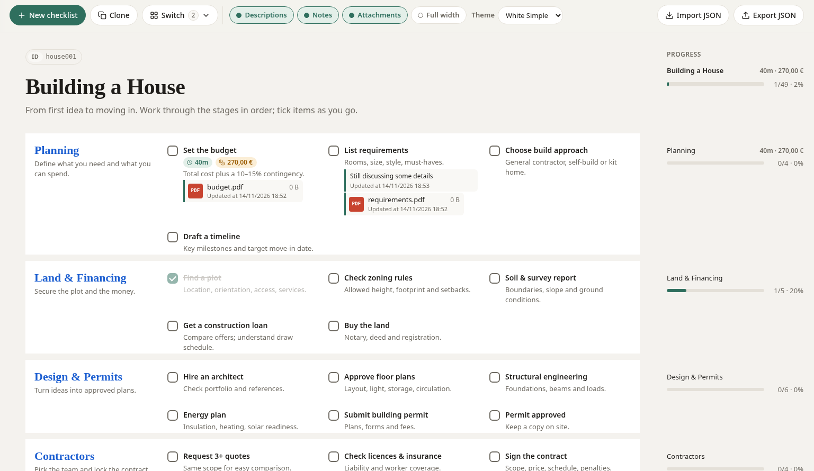

# checklist4life

Tiny portable single-file .html app which allows you to:

* Create separate checklist documents, made of stages and checklists
* Each item has a title, descripion and a checkbox
* You can define **dynamic stages** and items
* You can **clone** a checklist document (which works as a template)
* You can **attach files**: pdfs, images, zip files to each item
* You can **add a note** to a check item
* You can **log time** and costs
* See the **time/cost/completion progress** of each stage or the full checklist
* **Export/Import** checklists
* Change **themes**

Useful to work in systematic processes to not miss any step while managing the data, time, cost and progress in a single place.
